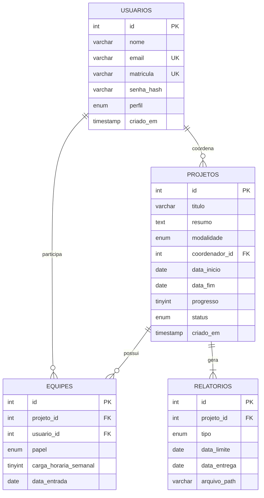

# Modelagem de Dados — Gestão de Projetos (IFPA)

Tema 2 · Ensino, Pesquisa e Extensão · BCC · Campus Tucuruí

## 1. Modelagem conceitual

Entidades principais:

| Entidade | Descrição |
|---|---|
| **Usuario** | Docente, discente ou técnico que participa do sistema |
| **Projeto** | Ação de ensino, pesquisa ou extensão, com vigência e coordenador |
| **Equipe** | Associação N:N entre usuário e projeto, com papel e carga horária |
| **Relatorio** | Relatório parcial ou final de um projeto, com prazo automático |

Relacionamentos:

- Um **Usuario** (docente) **coordena** vários **Projetos**
- Um **Projeto** possui vários membros via **Equipe**
- Um **Projeto** gera exatamente dois **Relatorios** (Parcial e Final)
- A situação do relatório (Pendente / Entregue / Atrasado) é **derivada** da data de entrega e do prazo

Regras de negócio refletidas no modelo:

1. Coordenador do projeto deve ser Docente
2. Vigência mínima de 7 dias
3. Prazo parcial = metade da vigência; prazo final = data de término
4. Cada usuário participa no máximo uma vez por projeto

## 2. Modelagem lógica

```
USUARIOS (id PK, nome, email UK, matricula UK, senha_hash, perfil, criado_em)
PROJETOS (id PK, titulo, resumo, modalidade, coordenador_id FK→USUARIOS, data_inicio, data_fim, progresso, status, criado_em)
EQUIPES (id PK, projeto_id FK→PROJETOS, usuario_id FK→USUARIOS, papel, carga_horaria_semanal, data_entrada)
          UK (projeto_id, usuario_id)
RELATORIOS (id PK, projeto_id FK→PROJETOS, tipo, data_limite, data_entrega, arquivo_path)
            UK (projeto_id, tipo)
```

## 3. Diagrama DER (Mermaid)



## 4. Diagrama físico / DBML

Arquivo pronto para colar em [dbdiagram.io](https://dbdiagram.io): `docs/modelo.dbml`.

O script SQL de criação está em `schema.sql` (MySQL/MariaDB), com triggers que:

- validam o coordenador docente
- inserem o coordenador na equipe
- criam os relatórios parcial e final com prazos automáticos

A view `vw_relatorios_situacao` calcula a situação em tempo de consulta (não grava status estático).

## 5. Como exportar o diagrama visual

1. Abra https://dbdiagram.io
2. Cole o conteúdo de `docs/modelo.dbml`
3. Exporte PNG/PDF para anexar no relatório ou slides
4. Alternativa: cole o bloco Mermaid acima no [mermaid.live](https://mermaid.live)
